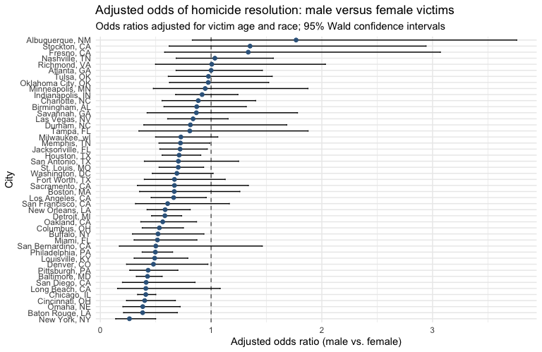

P8105 HW6
================
Yifan Wan

## Problem 1: Homicide investigations

``` r
homicide_df =
  read_csv("data/homicide-data.csv", show_col_types = FALSE) |>
  mutate(
    city_state = str_c(city, state, sep = ", "),
    resolved = as.numeric(disposition == "Closed by arrest"),
    victim_age = as.numeric(victim_age),
    victim_race = factor(victim_race, levels = c("White", "Black")),
    victim_sex = factor(victim_sex, levels = c("Female", "Male"))
  ) |>
  filter(
    !city_state %in% c("Dallas, TX", "Phoenix, AZ", "Kansas City, MO", "Tulsa, AL"),
    victim_race %in% c("White", "Black")
  ) |>
  drop_na(resolved, victim_age, victim_sex, victim_race)

homicide_df |>
  count(city_state, name = "number_of_cases") |>
  knitr::kable()
```

| city_state         | number_of_cases |
|:-------------------|----------------:|
| Albuquerque, NM    |             173 |
| Atlanta, GA        |             940 |
| Baltimore, MD      |            2753 |
| Baton Rouge, LA    |             409 |
| Birmingham, AL     |             763 |
| Boston, MA         |             487 |
| Buffalo, NY        |             472 |
| Charlotte, NC      |             571 |
| Chicago, IL        |            4502 |
| Cincinnati, OH     |             678 |
| Columbus, OH       |            1019 |
| Denver, CO         |             208 |
| Detroit, MI        |            2440 |
| Durham, NC         |             230 |
| Fort Worth, TX     |             383 |
| Fresno, CA         |             210 |
| Houston, TX        |            1875 |
| Indianapolis, IN   |            1237 |
| Jacksonville, FL   |            1138 |
| Las Vegas, NV      |             908 |
| Long Beach, CA     |             186 |
| Los Angeles, CA    |            1052 |
| Louisville, KY     |             549 |
| Memphis, TN        |            1421 |
| Miami, FL          |             430 |
| Milwaukee, wI      |             994 |
| Minneapolis, MN    |             299 |
| Nashville, TN      |             745 |
| New Orleans, LA    |            1339 |
| New York, NY       |             412 |
| Oakland, CA        |             740 |
| Oklahoma City, OK  |             510 |
| Omaha, NE          |             361 |
| Philadelphia, PA   |            2615 |
| Pittsburgh, PA     |             620 |
| Richmond, VA       |             301 |
| Sacramento, CA     |             234 |
| San Antonio, TX    |             309 |
| San Bernardino, CA |             152 |
| San Diego, CA      |             268 |
| San Francisco, CA  |             462 |
| Savannah, GA       |             224 |
| St. Louis, MO      |            1637 |
| Stockton, CA       |             191 |
| Tampa, FL          |             178 |
| Tulsa, OK          |             511 |
| Washington, DC     |            1226 |

`resolved = 1` denotes cases closed by arrest; `resolved = 0` denotes
cases not closed by arrest. The comparison of interest is **Male versus
Female**, holding victim age and race fixed.

``` r
baltimore_fit =
  homicide_df |>
  filter(city_state == "Baltimore, MD") |>
  glm(resolved ~ victim_age + victim_sex + victim_race,
      data = _, family = binomial())

broom::tidy(baltimore_fit) |>
  mutate(
    adjusted_or = exp(estimate),
    or_ci_lower = exp(estimate - 1.96 * std.error),
    or_ci_upper = exp(estimate + 1.96 * std.error)
  ) |>
  knitr::kable(digits = 3)
```

| term | estimate | std.error | statistic | p.value | adjusted_or | or_ci_lower | or_ci_upper |
|:---|---:|---:|---:|---:|---:|---:|---:|
| (Intercept) | 1.152 | 0.237 | 4.865 | 0.000 | 3.164 | 1.989 | 5.031 |
| victim_age | -0.007 | 0.003 | -2.024 | 0.043 | 0.993 | 0.987 | 1.000 |
| victim_sexMale | -0.854 | 0.138 | -6.184 | 0.000 | 0.426 | 0.325 | 0.558 |
| victim_raceBlack | -0.842 | 0.175 | -4.818 | 0.000 | 0.431 | 0.306 | 0.607 |

``` r
baltimore_result =
  broom::tidy(baltimore_fit) |>
  filter(term == "victim_sexMale") |>
  transmute(
    city_state = "Baltimore, MD",
    adjusted_or = exp(estimate),
    lower_ci = exp(estimate - 1.96 * std.error),
    upper_ci = exp(estimate + 1.96 * std.error)
  )

baltimore_result |> knitr::kable(digits = 3)
```

| city_state    | adjusted_or | lower_ci | upper_ci |
|:--------------|------------:|---------:|---------:|
| Baltimore, MD |       0.426 |    0.325 |    0.558 |

The adjusted odds ratio for case resolution comparing male victims with
female victims in Baltimore is 0.426 (95% CI: 0.325 to 0.558). An odds
ratio less than 1 indicates lower adjusted odds of a case being closed
by arrest for male victims; an odds ratio greater than 1 indicates
higher adjusted odds.

``` r
city_or_df =
  homicide_df |>
  nest(city_data = -city_state) |>
  mutate(
    models = map(city_data, \(df) glm(
      resolved ~ victim_age + victim_sex + victim_race,
      data = df, family = binomial()
    )),
    estimates = map(models, broom::tidy)
  ) |>
  select(city_state, estimates) |>
  unnest(estimates) |>
  filter(term == "victim_sexMale") |>
  transmute(
    city_state,
    adjusted_or = exp(estimate),
    lower_ci = exp(estimate - 1.96 * std.error),
    upper_ci = exp(estimate + 1.96 * std.error)
  ) |>
  arrange(adjusted_or)

city_or_df |> knitr::kable(digits = 3)
```

| city_state         | adjusted_or | lower_ci | upper_ci |
|:-------------------|------------:|---------:|---------:|
| New York, NY       |       0.262 |    0.138 |    0.499 |
| Baton Rouge, LA    |       0.381 |    0.209 |    0.695 |
| Omaha, NE          |       0.382 |    0.203 |    0.721 |
| Cincinnati, OH     |       0.400 |    0.236 |    0.677 |
| Chicago, IL        |       0.410 |    0.336 |    0.501 |
| Long Beach, CA     |       0.410 |    0.156 |    1.082 |
| San Diego, CA      |       0.413 |    0.200 |    0.855 |
| Baltimore, MD      |       0.426 |    0.325 |    0.558 |
| Pittsburgh, PA     |       0.431 |    0.265 |    0.700 |
| Denver, CO         |       0.479 |    0.236 |    0.971 |
| Louisville, KY     |       0.491 |    0.305 |    0.790 |
| Philadelphia, PA   |       0.496 |    0.378 |    0.652 |
| San Bernardino, CA |       0.500 |    0.171 |    1.462 |
| Miami, FL          |       0.515 |    0.304 |    0.872 |
| Buffalo, NY        |       0.521 |    0.290 |    0.935 |
| Columbus, OH       |       0.532 |    0.378 |    0.750 |
| Oakland, CA        |       0.563 |    0.365 |    0.868 |
| Detroit, MI        |       0.582 |    0.462 |    0.734 |
| New Orleans, LA    |       0.585 |    0.422 |    0.811 |
| San Francisco, CA  |       0.608 |    0.317 |    1.165 |
| Los Angeles, CA    |       0.662 |    0.458 |    0.956 |
| Boston, MA         |       0.667 |    0.354 |    1.260 |
| Sacramento, CA     |       0.669 |    0.335 |    1.337 |
| Fort Worth, TX     |       0.669 |    0.397 |    1.127 |
| Washington, DC     |       0.691 |    0.469 |    1.018 |
| St. Louis, MO      |       0.703 |    0.530 |    0.932 |
| San Antonio, TX    |       0.705 |    0.398 |    1.249 |
| Houston, TX        |       0.711 |    0.558 |    0.907 |
| Jacksonville, FL   |       0.720 |    0.537 |    0.966 |
| Memphis, TN        |       0.723 |    0.529 |    0.988 |
| Milwaukee, wI      |       0.727 |    0.499 |    1.060 |
| Tampa, FL          |       0.808 |    0.348 |    1.876 |
| Durham, NC         |       0.812 |    0.392 |    1.683 |
| Las Vegas, NV      |       0.837 |    0.608 |    1.154 |
| Savannah, GA       |       0.867 |    0.422 |    1.780 |
| Birmingham, AL     |       0.870 |    0.574 |    1.318 |
| Charlotte, NC      |       0.884 |    0.557 |    1.403 |
| Indianapolis, IN   |       0.919 |    0.679 |    1.242 |
| Minneapolis, MN    |       0.947 |    0.478 |    1.875 |
| Oklahoma City, OK  |       0.974 |    0.624 |    1.520 |
| Tulsa, OK          |       0.976 |    0.614 |    1.552 |
| Atlanta, GA        |       1.000 |    0.684 |    1.463 |
| Richmond, VA       |       1.006 |    0.498 |    2.033 |
| Nashville, TN      |       1.034 |    0.685 |    1.562 |
| Fresno, CA         |       1.335 |    0.580 |    3.071 |
| Stockton, CA       |       1.352 |    0.621 |    2.942 |
| Albuquerque, NM    |       1.767 |    0.831 |    3.761 |

``` r
city_or_df |>
  mutate(city_state = fct_reorder(city_state, adjusted_or)) |>
  ggplot(aes(x = adjusted_or, y = city_state)) +
  geom_vline(xintercept = 1, linetype = "dashed", color = "gray40") +
  geom_errorbar(aes(xmin = lower_ci, xmax = upper_ci), width = 0.2) +
  geom_point(size = 1.7, color = "steelblue4") +
  labs(
    title = "Adjusted odds of homicide resolution: male versus female victims",
    subtitle = "Odds ratios adjusted for victim age and race; 95% Wald confidence intervals",
    x = "Adjusted odds ratio (male vs. female)",
    y = "City"
  )
```



The graph orders cities by their adjusted odds ratios. The dashed
vertical line indicates an odds ratio of 1. Estimates to the left of 1
indicate lower odds of resolution for male victims, while estimates to
the right indicate higher odds. Confidence intervals crossing 1 do not
provide strong evidence of a sex difference at the 5% significance
level.
